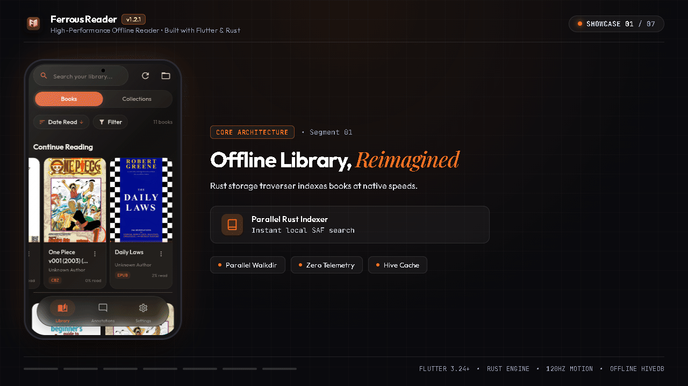
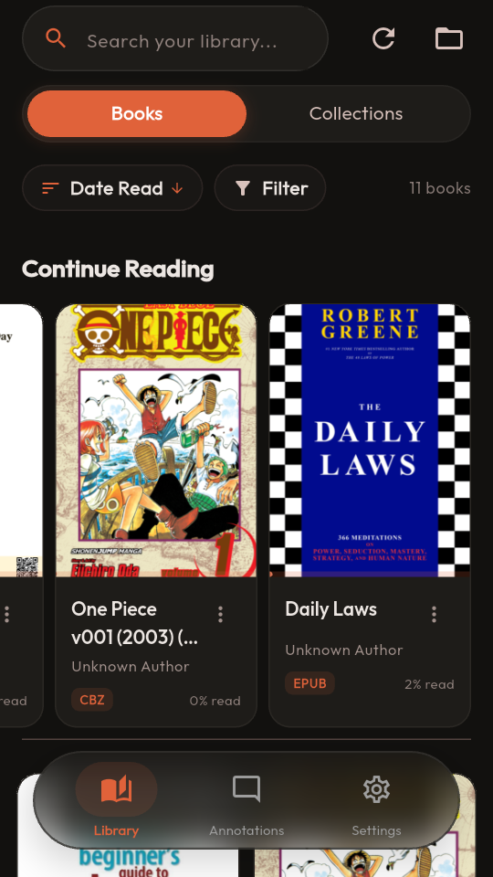
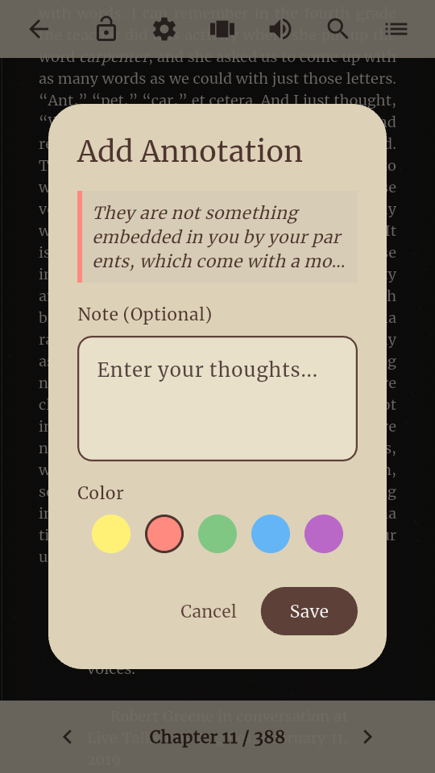
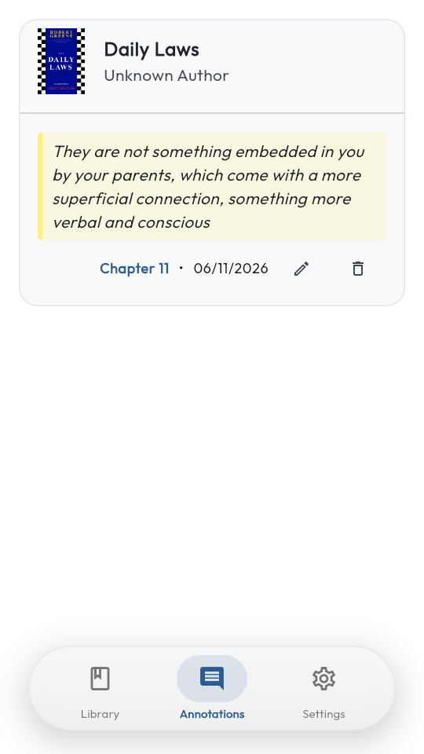
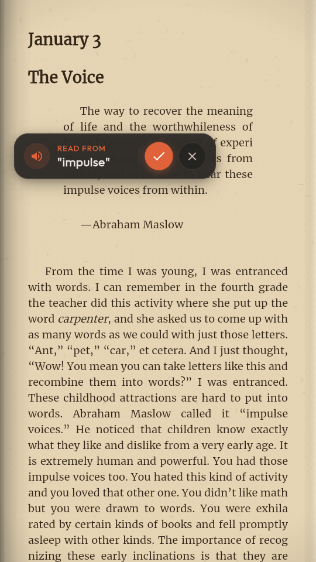
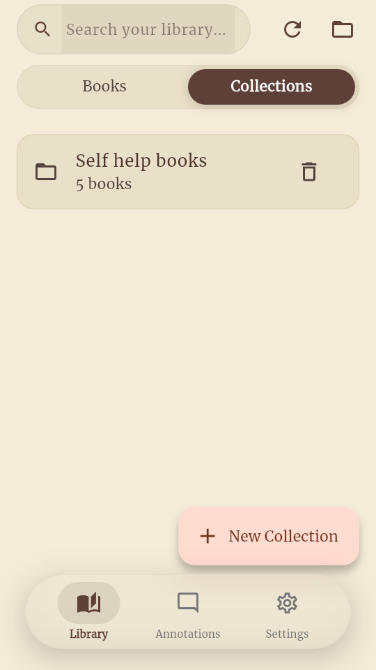
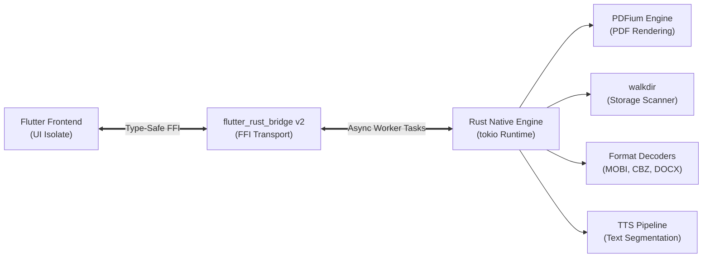

<p align="center">
  
</p>

<h1 align="center">Ferrous Reader</h1>

<p align="center">
  <strong>A high-performance offline document and book reader for Android, built with Flutter and Rust.</strong>
</p>

<p align="center">
  <a href="https://github.com/JuanSoFly/Ferrous/releases/latest"></a>
  
  
  
  
</p>

<p align="center">
  <a href="https://github.com/JuanSoFly/Ferrous/releases/latest">
    
  </a>
  <a href="https://apps.obtainium.imranr.dev/redirect?r=obtainium://add/https://github.com/JuanSoFly/Ferrous">
    
  </a>
</p>

<p align="center">
  
</p>

<p align="center">
  <a href="#download">Download</a> •
  <a href="#overview">Overview</a> •
  <a href="#app-walkthrough">App Walkthrough</a> •
  <a href="#key-features">Key Features</a> •
  <a href="#supported-formats">Supported Formats</a> •
  <a href="#architecture">Architecture</a> •
  <a href="#technical-specifications">Technical Specifications</a> •
  <a href="#prerequisites">Prerequisites</a> •
  <a href="#getting-started">Getting Started</a> •
  <a href="#building-releases">Building Releases</a> •
  <a href="#project-structure">Project Structure</a> •
  <a href="#troubleshooting">Troubleshooting</a>
</p>

---

## Download

Precompiled Android packages (APKs) are available on the [GitHub Releases](https://github.com/JuanSoFly/Ferrous/releases/latest) page, or automatically via [Obtainium](https://apps.obtainium.imranr.dev/redirect?r=obtainium://add/https://github.com/JuanSoFly/Ferrous):

| Architecture | Target Devices | Release Asset |
| :--- | :--- | :--- |
| **`arm64-v8a`** | Modern 64-bit phones & tablets *(Recommended)* | [`ferrous-v1.2.1-arm64-v8a.apk`](https://github.com/JuanSoFly/Ferrous/releases/download/v1.2.1/ferrous-v1.2.1-arm64-v8a.apk) |
| **`armeabi-v7a`** | Legacy 32-bit Android devices | [`ferrous-v1.2.1-armeabi-v7a.apk`](https://github.com/JuanSoFly/Ferrous/releases/download/v1.2.1/ferrous-v1.2.1-armeabi-v7a.apk) |
| **`x86_64`** | Android emulators & ChromeOS | [`ferrous-v1.2.1-x86_64.apk`](https://github.com/JuanSoFly/Ferrous/releases/download/v1.2.1/ferrous-v1.2.1-x86_64.apk) |

> [!TIP]
> If you are unsure which build your phone requires, choose **`arm64-v8a`**, which works on virtually all modern Android devices.

---

## Overview

Ferrous Reader is an open-source, offline-first mobile reading application designed for speed, low memory overhead, and typography control. By combining a reactive **Flutter** front-end with an asynchronous **Rust** backend via `flutter_rust_bridge` (v2), Ferrous offloads computationally intensive workloads—such as PDF parsing, full-storage indexing, archive decompression, and text tokenization—to background native threads, keeping UI animations and page interactions fluid at 120Hz.

> [!NOTE]
> Ferrous is fully offline. It operates with zero telemetry, zero analytics, and persists all library metadata, reading locations, and annotations locally on the device using Hive.

---

## App Walkthrough

Experience Ferrous Reader's tactile 120Hz interface, native typography engine, and seamless offline library management:

| 01. Offline Library & Carousel | 02. Reflowable EPUB Typography | 03. Realistic 3D Page Turn |
| :---: | :---: | :---: |
|  |  |  |
| **Instant Library Indexing**<br/>Parallel Rust `walkdir` storage scan, "Continue Reading" shelf, and format filtering. | **Native Non-WebView Engine**<br/>Reflowable text in native Flutter widgets with custom margins and book textures. | **120 FPS Physics Curl**<br/>Hardware-accelerated page curls with dynamic lighting and ambient shadow simulation. |

| 04. Rich In-Text Annotations | 05. Annotations Hub | 06. Synchronized Text-to-Speech | 07. Custom Collections |
| :---: | :---: | :---: | :---: |
|  |  |  |  |
| **5-Color Highlighter**<br/>Yellow, coral, green, blue, and purple highlighting with instant note attachments. | **Centralized Notes Store**<br/>Global review hub organizing all quotes, notes, and chapter bookmarks locally. | **Non-Blocking TTS**<br/>Sentence lock tracking with floating audio controls running on native worker threads. | **Android SAF Storage**<br/>Scoped storage compliant directory mapping and custom reading shelf organization. |

---

## Key Features

- **Blazing Fast File Indexing**: Scans device storage and Storage Access Framework (SAF) trees in seconds via parallel directory traversal in Rust (`walkdir`).
- **Smooth 120Hz UI**: Heavy I/O and document decoding run asynchronously outside the UI isolate on a Rust thread pool (`tokio`), avoiding frame drops.
- **Hardware-Accelerated PDF Rendering**: Powered by Google PDFium via `pdfium-render`, generating thread-safe bitmaps directly for Flutter textures.
- **Native Non-WebView EPUB Engine**: Renders reflowable book content directly into a native Flutter widget tree with hyphenation and full typography control.
- **Synchronized Text-to-Speech (TTS)**: Integrated TTS with dynamic word and sentence highlighting across page boundaries and chapters.
- **Granular Library Management**: Multi-directory library location support via Android Storage Access Framework (SAF), collection grouping, advanced sorting, and format filtering.
- **Material 3 Design**: Dynamic color palette adaptation, customizable themes, reading progress persistence, and animated shimmer placeholders.

---

## Supported Formats

| Format | Parsing Engine | Rendering Pipeline | Capabilities |
| :--- | :--- | :--- | :--- |
| **PDF** (`.pdf`) | Rust (`pdfium-render`) | Native texture bitmaps | Fast page flipping, text selection, TTS extraction, continuous scroll |
| **EPUB** (`.epub`) | Dart (`epubx`) + Rust cover extractor | Native Flutter widgets (`flutter_html`) | Custom typography, margins, line-height, hyphenation, CSS themes |
| **MOBI / AZW / AZW3** (`.mobi`, `.azw`, `.azw3`) | Rust (`mobi`) | HTML parser & native widgets | Chapter navigation, embedded images, metadata extraction |
| **Comic Archives** (`.cbz`, `.zip`) | Rust (`zip`) | Canvas image stream | Direct archive stream extraction, pinch-to-zoom, page spread |
| **Plain Text** (`.txt`) | Rust (`txt`) | Rich HTML & layout widgets | Formatted indentation, lists, checkboxes, and Mermaid diagram rendering |
| **Word Documents** (`.docx`) | Rust (`docx-rs`) | Structured HTML widgets | Document flow, paragraph formatting, and styled table layouts |

---

## Architecture

Ferrous utilizes a hybrid boundary model where Flutter handles UI composition and state presentation, while Rust manages high-throughput, latency-critical operations.



### Separation of Concerns

- **Flutter (Frontend)**:
  - Material 3 user interface with dynamic theme switching and smooth gesture interactions.
  - Responsive reading screens for both paginated and continuous scroll modes.
  - Hive NoSQL database for instant bookmarking, reading progress tracking, and collection management.
- **Rust (Backend)**:
  - Multi-threaded, non-blocking I/O operations powered by `tokio`.
  - PDFium binding management with safe, asynchronous document loading and page caching.
  - Archive reading (`zip`) for fast on-the-fly cover extraction without writing temporary files to disk.
  - Text segmentation and tokenization for sentence-level TTS highlighting.

---

## Technical Specifications

| Component | Technology | Role & Details |
| :--- | :--- | :--- |
| **Target OS** | Android 7.0+ (API Level 24+) | Supports `arm64-v8a`, `armeabi-v7a`, `x86_64` |
| **Frontend Framework** | Flutter 3.24+ (Dart 3.5+) | Material 3 UI, custom renderers, gesture recognizers |
| **Backend Language** | Rust 1.80+ (2021 Edition) | High-performance compute engine and file I/O |
| **FFI Layer** | `flutter_rust_bridge` 2.11.1 | Auto-generated, type-safe foreign function interface |
| **PDF Renderer** | Google PDFium (`pdfium-render`) | Native C++ rendering via dynamic binary loading |
| **Database** | Hive (`hive_flutter`) | Fast, lightweight embedded key-value document store |
| **Concurrency** | `tokio` (Rust) | Multi-worker thread pool executing off the UI isolate |
| **File Access** | Android SAF + Rust `walkdir` | Scoped storage compliance with rapid recursive traversal |

---

## Prerequisites

Before building Ferrous, ensure the following tools are installed on your host system:

- **Flutter SDK**: `3.24.0` or higher ([Installation Guide](https://docs.flutter.dev/get-started/install))
- **Rust Toolchain**: `1.80.0` or higher (`stable`)
  ```bash
  rustup default stable
  ```
- **Android Targets for Rust**:
  ```bash
  rustup target add aarch64-linux-android armv7-linux-androideabi x86_64-linux-android
  ```
- **Android NDK**: Version `r26d` or `r26b` (configured via `ANDROID_NDK_HOME`)
- **JDK**: Java Development Kit 17 (Temurin recommended)
- **flutter_rust_bridge_codegen**:
  ```bash
  cargo install flutter_rust_bridge_codegen --version 2.11.1
  ```

---

## Getting Started

Follow these steps to set up the development environment, compile dependencies, and run Ferrous on an Android device or emulator.

### 1. Clone the Repository

```bash
git clone https://github.com/JuanSoFly/Ferrous.git
cd Ferrous
```

### 2. Configure Environment (Optional)

If you use local tool paths, you can source the environment helper:

```bash
source ./setup_env.sh
```

### 3. Fetch Flutter Dependencies

```bash
flutter pub get
```

### 4. Generate Bridge Bindings

Generate the type-safe FFI glue code between Dart and Rust:

```bash
flutter_rust_bridge_codegen generate
```

### 5. Install PDFium Binaries

Ferrous requires `libpdfium.so` for each targeted Android architecture. An automated helper script is provided to download and place prebuilt binaries:

```bash
# Default installs arm64-v8a and armeabi-v7a
bash scripts/setup-pdfium-android.sh
```

> [!TIP]
> If developing on an Android emulator, include `x86_64`:
> ```bash
> PDFIUM_ABIS="arm64-v8a,x86_64" bash scripts/setup-pdfium-android.sh
> ```
> For offline manual setup instructions, refer to [docs/pdfium-setup.md](docs/pdfium-setup.md).

### 6. Run the App

Connect an Android device with USB debugging enabled (or start an emulator) and execute:

```bash
flutter run
```

---

## Building Releases

To generate optimized Android production packages:

### Split APKs (Recommended)

Generating separate APKs per ABI significantly reduces download sizes:

```bash
flutter build apk --split-per-abi --release
```

Outputs are generated in:
`build/app/outputs/flutter-apk/`
- `app-arm64-v8a-release.apk` (modern 64-bit devices)
- `app-armeabi-v7a-release.apk` (legacy 32-bit devices)
- `app-x86_64-release.apk` (emulators & ChromeOS)

### Android App Bundle (AAB)

For distribution through Google Play:

```bash
flutter build appbundle --release
```

Output:
`build/app/outputs/bundle/release/app-release.aab`

---

## Project Structure

```text
Ferrous/
├── .github/workflows/       # CI/CD automated release pipelines
├── android/                 # Android native project & SAF integration
│   └── app/src/main/jniLibs # Target ABI native libraries (libpdfium.so)
├── assets/                  # Application launcher icons & visual assets
├── docs/                    # Technical guides (PDFium setup, architecture notes)
├── lib/                     # Flutter / Dart presentation layer
│   ├── app/                 # Application shell & routing
│   ├── core/                # Models, utilities, constants, and widgets
│   ├── data/                # Repositories & Hive database services
│   ├── features/            # Feature modules (library, reader, collections, settings)
│   └── src/rust/            # Generated Dart FFI bridge code
├── rust/                    # Native Rust compute crate
│   ├── Cargo.toml           # Rust crate dependencies & release profiles
│   └── src/api/             # Rust exposed API modules (PDF, MOBI, CBZ, TXT, DOCX, scanning)
├── rust_builder/            # Cargokit integration layer for cross-compiling Rust
└── scripts/                 # Automation scripts (setup-pdfium-android.sh)
```

---

## Troubleshooting

### Missing PDFium Library (`dlopen failed`)

> [!IMPORTANT]
> If the app crashes on opening a PDF with `Failed to bind to pdfium library: dlopen failed: library "libpdfium.so" not found`, ensure that `scripts/setup-pdfium-android.sh` has been executed for your target device's ABI, and verify that `android/app/src/main/jniLibs/<abi>/libpdfium.so` exists before running `flutter run`.

### Out-of-Sync FFI Bindings

If you modify files under `rust/src/api/`, re-run the code generator to update the Dart bindings:

```bash
flutter_rust_bridge_codegen generate
```

---

<p align="center">
  
</p>

